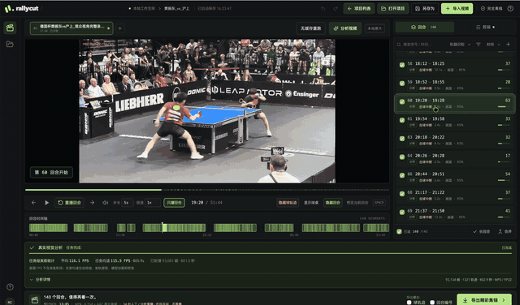
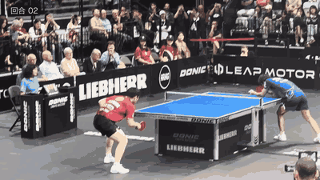

# RallyCut

[中文](README.md) · English

**Keep every great point.** RallyCut turns a full table tennis match video into a highlight reel of the rallies worth watching again.

[Download the preview](https://rallycut-app.pages.dev/en/#download) · [See the app](https://rallycut-app.pages.dev/en/#workbench) · [See an export](https://rallycut-app.pages.dev/en/#demo) · [English guide](https://rallycut-app.pages.dev/en/guide/)

## See the workbench first

**Review rallies one by one on the right; see the whole match on the timeline below.** Click the animation to watch the 19-second screen recording (first second trimmed, no audio). Click a rally to replay it, adjust its start and end, tick the clips you want, then export.

More: what an exported highlight looks like

*A real export from Fan Zhendong match footage: the orange line follows the ball and the rally number sits in the top-left corner. The full demo keeps the original audio.*

## What it does

- **Finds rallies**: import a match video and get candidate rallies instead of scrubbing the timeline.
- **Shows the ball**: replay the ball trajectory to check each point.
- **Lets you correct it**: combine machine analysis with your own edits; at export time choose whose result wins. Undo and redo are supported.
- **Exports highlights**: tick the rallies to keep and export an MP4, optionally with **the ball trajectory and rally numbers burned in**.

## Getting started

1. [Download the installer](https://github.com/sundy-li/rallycut/releases/tag/v0.1.0-alpha.3) and follow the [install guide](docs/getting-started.en.md) for first-run setup.
2. Create a project → import a video → analyze and review the rallies.
3. In the export bar, tick “Ball trajectory” and “Rally numbers”, then export.

Videos are processed on your computer and never uploaded. This is an early preview. **Source code and installers are public; no invitation or sign-in is needed to browse or download.** macOS comes first; Windows support is experimental. The full Windows installer bundles its dependencies and only downloads the model after you confirm; on macOS the app prepares a private environment after you confirm. You do not need to install Python or FFmpeg. Installers are not yet signed by a registered publisher or notarized by Apple, and automatic results still need a human review.

The app interface is currently in Chinese.

[Install and use](docs/getting-started.en.md) · [FAQ](docs/faq.en.md) · [Release notes](docs/releases.en.md)

---

Developers (Chinese): [Development and tests](docs/development.md) · [Algorithms and experiments](docs/experiments.md) · [Publishing](docs/publishing.zh-CN.md) · [Licenses](docs/licenses.md)
