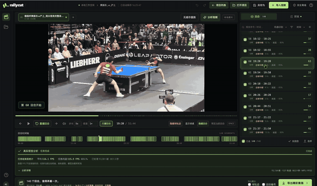
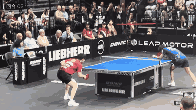

# RallyCut

**让每个好球，留下来。** 把整场乒乓球视频，剪成值得回看的回合集锦。

[下载种子版](https://rallycut-byc.pages.dev/#download) · [看软件界面](https://rallycut-byc.pages.dev/#workbench) · [看导出效果](https://rallycut-byc.pages.dev/#demo) · [中文指南](https://rallycut-byc.pages.dev/guide/)

## 先看主界面：回合怎么拆

**右侧逐个看回合，底部总览整场。** 点击动图观看约 19 秒的真实操作录屏（已剪去开头 1 秒，无音轨）。点击回合回放，复核或调整起止点，勾选想保留的片段，再导出集锦。

补充演示：再看导出后的效果

*樊振东比赛素材的实际导出片段：橙色线条跟随球的轨迹，左上角显示回合编号。完整演示带原声，点击观看。*

## 它能做什么

- **找回合**：导入比赛视频，自动生成候选回合，少拖一点进度条。
- **看轨迹**：回放球的运动轨迹，复核精彩瞬间。
- **改剪辑**：机器分析与人工修正结合，导出时可选人工优先等覆盖方式，支持撤销与重做。
- **出集锦**：勾选想保留的回合，导出 MP4；可把**球轨迹和回合编号一起放进视频**。

## 开始使用

1. [下载安装包](https://github.com/sundy-li/rallycut/releases/tag/v0.1.0-alpha.3)，按[安装指南](docs/getting-started.zh-CN.md)完成首次准备。
2. 新建项目 → 导入视频 → 分析并复核回合。
3. 在导出栏勾选“球轨迹”“回合编号”，导出你的集锦。

视频在本机处理，不需要上传。当前为早期预览版，**源码和安装包已公开，无需邀请或登录即可浏览、下载**；macOS 优先，Windows 为实验性支持。Windows 完整安装器已含依赖，缺模型时确认后下载；macOS 首次确认后准备私有环境，无需手动安装 Python／FFmpeg。安装包尚未完成正式发布者签名／公证；自动识别结果仍需人工复核。

[安装与使用](docs/getting-started.zh-CN.md) · [常见问题](docs/faq.zh-CN.md) · [本版更新](docs/releases.zh-CN.md)

---

开发者：[开发与测试](docs/development.md) · [算法与实验记录](docs/experiments.md) · [发布维护](docs/publishing.zh-CN.md) · [许可证](docs/licenses.md)
